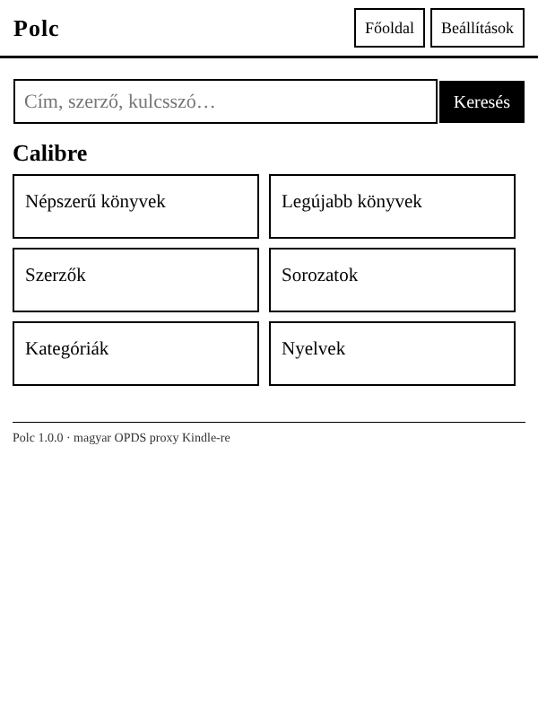
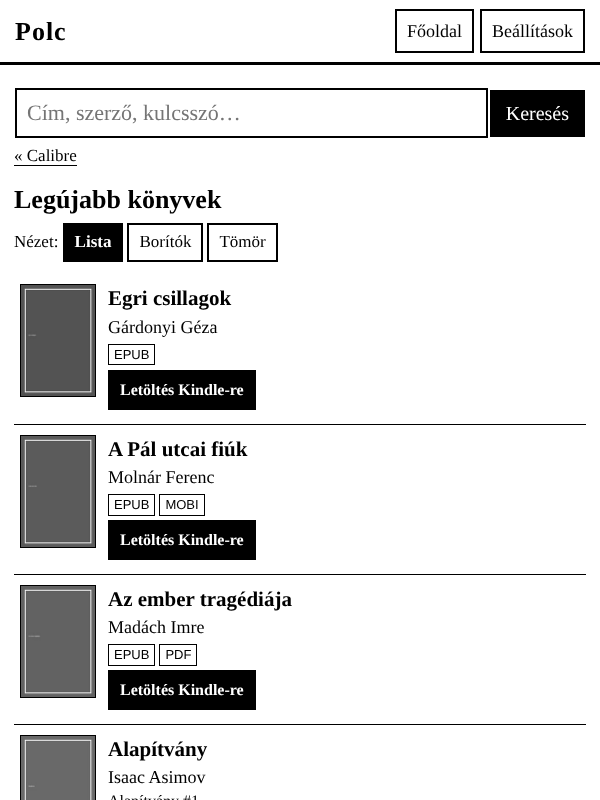
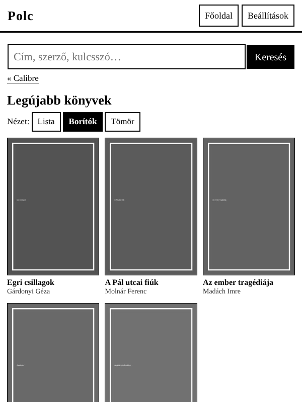
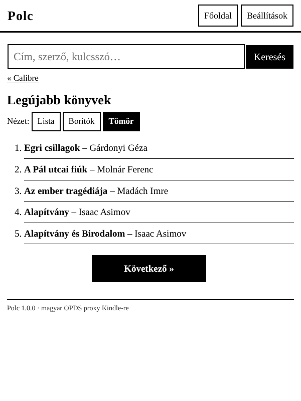
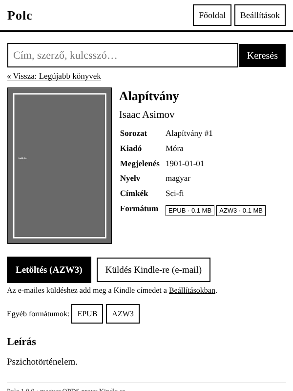
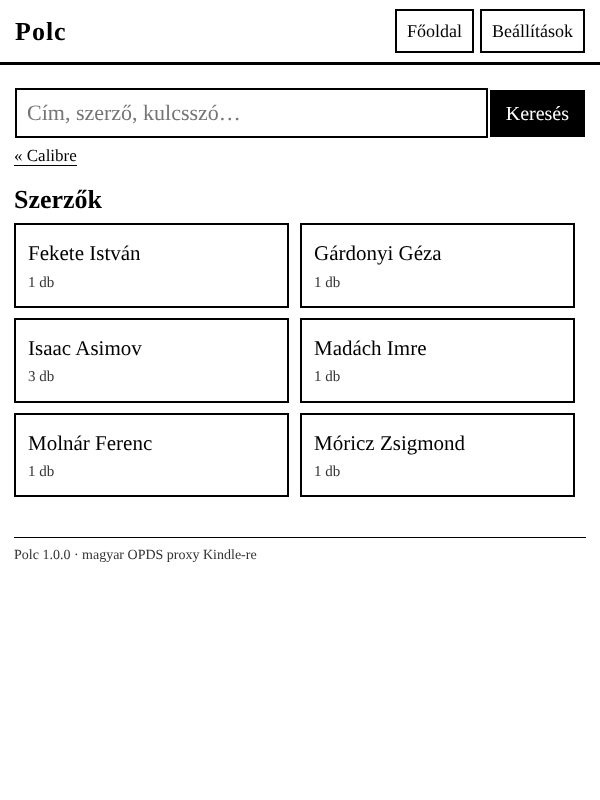

# Polc

Magyar nyelvű, Kindle-barát OPDS proxy. A Calibre / Calibre-Web OPDS katalógusát egyszerű, e-ink-re optimalizált weboldallá alakítja, így a **Kindle beépített böngészőjéből** közvetlenül böngészhetsz, kereshetsz és tölthetsz le könyveket.

## Funkciók

- **Magyar felület**, a Calibre-Web angol menüpontjait is magyarra fordítja (Népszerű könyvek, Szerzők, Sorozatok…)
- **Három nézet:** Lista (borító + adatok + gyors letöltés), Borítók (rács), Tömör (csak szöveg, leggyorsabb e-inken). A választást megjegyzi.
- **Keresés** minden oldalon (OpenSearch alapján)
- **Könyv adatlap:** borító, szerző, sorozat és sorszám, kiadó, nyelv, címkék, formátumok és méret, leírás
- **Letöltés Kindle-re:** EPUB → **AZW3** konverzió Calibre `ebook-convert`-tel (szebb, mint a régi MOBI), **beágyazott borítóval**, címmel, szerzővel és sorozattal, így a Kindle könyvtárában is látszik a borító. Ha a könyvtárban már van AZW3/MOBI, azt adja.
- **Küldés Kindle-re e-mailben** (Amazon Send-to-Kindle): EPUB-ot küld beágyazott borítóval, felhőbe szinkronizál
- **Ékezetmentes fájlnevek** (a Kindle böngészője nem szereti az ékezetes neveket)
- **Szürkeárnyalatos, átméretezett borítók** gyorsítótárazva, így gyorsabban tölt az e-inken
- **Belépés** egyszer, titkosított sütiben megjegyezve; vagy előre beállított felhasználó a stackben
- Nincs flexbox és nincs JavaScript, így régi Kindle böngészőn is működik

## Képernyőképek

Kindle méretben (600×800), teszt-könyvtárral:

| Főoldal | Lista nézet | Borítók nézet |
|---|---|---|
|  |  |  |
| **Tömör nézet** | **Könyv adatlap** | **Szerzők** |
|  |  |  |

## Beállítások (környezeti változók)

| Változó | Alapérték | Leírás |
|---|---|---|
| `FEED_URL` | – | OPDS katalógus címe, pl. `http://192.168.0.100:18082/opds` |
| `FEED_NAME` | Könyvtár 1 | Megjelenített név |
| `FEED_USERNAME`, `FEED_PASSWORD` | – | Ha meg van adva, nincs belépés a Kindle-en |
| `FEED_2_URL` … `FEED_9_URL` | – | További könyvtárak (`_NAME`, `_USERNAME`, `_PASSWORD` is) |
| `PORT` | 8080 | Belső port a konténerben |
| `TITLE` | Polc | Az oldal neve |
| `DEFAULT_VIEW` | lista | `lista`, `racs` vagy `tomor` |
| `CONVERT_ENABLED` | true | EPUB → AZW3 konverzió |
| `CONVERT_TIMEOUT` | 300 | Konverzió időkorlátja (mp) |
| `CONVERT_PROFILE` | kindle_pw3 | Calibre kimeneti profil (pl. `kindle`, `kindle_oasis`, `kindle_scribe`) |
| `COVER_GRAYSCALE` | true | Szürkeárnyalatos borítók |
| `CACHE_TTL` | 120 | Katalógus-gyorsítótár (mp) |
| `SECRET_KEY` | automatikus | Süti-titkosítás kulcsa. Ha üres, a `/data/secret.key`-be generálja. |
| `SMTP_HOST`, `SMTP_PORT`, `SMTP_SECURITY`, `SMTP_USER`, `SMTP_PASSWORD`, `SMTP_FROM` | – | E-mail küldés (`SMTP_SECURITY`: `starttls`, `ssl` vagy `none`) |
| `KINDLE_EMAIL` | – | Alapértelmezett Kindle cím (a Beállítások oldalon felülírható) |

### Küldés Kindle-re e-mailben

1. Amazon: *Tartalom és eszközök → Beállítások → Személyes dokumentumok beállításai*. Itt találod a Kindle e-mail címedet (`…@kindle.com`), és itt kell a `SMTP_FROM` címet felvenni a **jóváhagyott feladók** közé.
2. Gmail esetén kétlépcsős azonosítás mellett **alkalmazásjelszót** kell készíteni az `SMTP_PASSWORD`-höz.

## Fejlesztés

```bash
pip install -r requirements.txt pytest
pytest -q tests                      # mock Calibre-Web szerver ellen fut
FEED_URL=http://192.168.0.100:18082/opds DATA_DIR=./data \
  uvicorn --factory app.main:create_app --reload --port 8080
```

A `WITH_CALIBRE=false` build-arggal Calibre nélküli, sokkal kisebb image készül, ilyenkor nincs konverzió.
